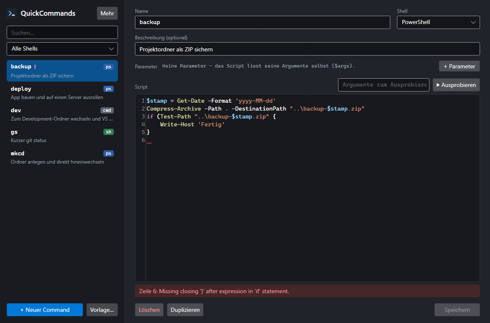
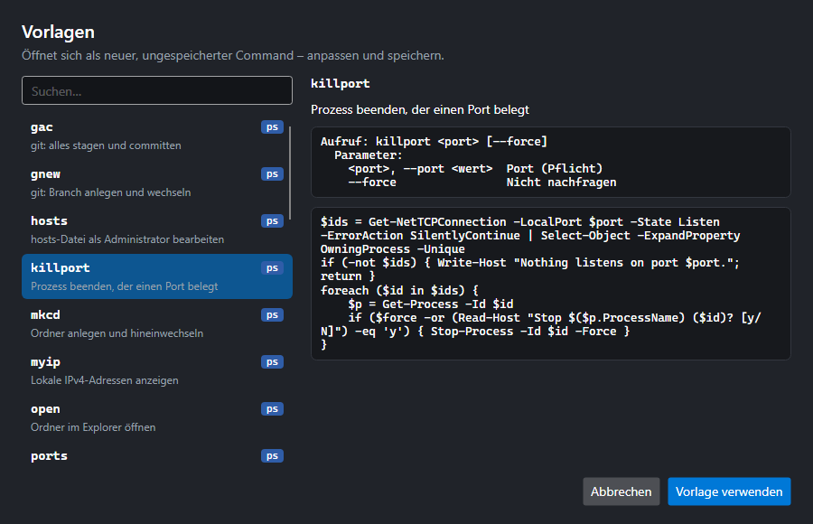

# QuickCommands

A small desktop app for managing your own terminal commands. You give a command a name like `dev`, `mkcd` or
`deploy`, write the script in **PowerShell**, **cmd** or **bash/zsh**, hit save, and it's available in your shell.
The app takes care of putting the files in the right place. Works on Windows, macOS and Linux.


## Install

| OS | How |
|---|---|
| Windows | `winget install FelixKriechbaum.QuickCommands` (once it's been accepted), or grab `QuickCommands-<version>-win-x64-setup.exe` from [Releases](../../releases). No admin rights needed. |
| macOS (14+) | `brew install --cask felixkriechbaum/tap/quickcommands`, or unzip `QuickCommands-<version>-macos-arm64.zip` (Apple Silicon) or `-x64.zip` (Intel) and drag the app into Applications. It isn't notarized, so on first launch you have to go to System Settings → Privacy & Security once and click "Open Anyway". |
| Linux | Extract `QuickCommands-<version>-linux-x64.tar.gz` and run `./install.sh`. That adds an entry to your app menu and puts `quickcommands` in `~/.local/bin`. `./install.sh --uninstall` removes both. |

On first launch a setup wizard asks which shells you use and where your commands should live. It shows you what it's
going to change before it changes anything. Uninstalling removes the profile lines and the PATH entry again; your
commands stay where they are.

## Features

- List of all your commands, with search, a shell filter and a badge for each shell
- Code editor with syntax highlighting. Syntax errors get a red underline while you type (PowerShell and bash/zsh;
  cmd doesn't have a parser you could ask).
- Parameters: set name, type (text, switch, choice), required, default and description in a form. From that the app
  generates the argument parsing, `--help` and tab completion for every shell.
- Try it (F5) runs whatever is in the editor right now in a new terminal, with arguments of your choice. Works on
  unsaved changes and doesn't save anything.
- Auto-reload: open PowerShell, bash and zsh windows pick up saved changes on their own. cmd sees them immediately
  anyway.
- Templates to start from (`mkcd`, `up`, `killport`, `serve`, `gac`, ...) and duplicate (Ctrl+D)
- Import functions and aliases from `$PROFILE`, `.bashrc` and `.zshrc`. If you want, the originals get commented
  out; the profile is backed up first.
- History: every save keeps a snapshot (last 50). You can restore a single command or everything.
- Conflict check: you get a warning if a name shadows an existing program, alias or shell command. Built-in cmd
  commands like `mkdir` or `cd` are blocked, because cmd always runs its own version.
- `qc` in a terminal lists your commands. `qc -a` lists them for all shells, `qc <name>` shows a command's help and
  `qc reload` reloads.
- The data folder can be moved (OneDrive, NAS, a Git repo) if you want the same commands on several machines.
- UI and terminal output in English and German, light/dark theme follows the system.

| | |
|---|---|
|  |  |
|  |  |

## Parameters

Say you have a command `deploy` with the parameters `app` (text, required), `target` (choice of `dev|staging|prod`,
default `dev`) and `force` (switch). Then all of these work in every shell:

```text
deploy web                     # positional
deploy web prod --force        # mixed
deploy --app=web --target prod
deploy -app web -target prod   # PowerShell style, works everywhere
deploy --help                  # help listing all parameters
```

Inside the script the values are plain variables. Anything that doesn't match a parameter ends up in the usual
argument list:

| Shell | Parameters | Remaining arguments |
|---|---|---|
| PowerShell | `$app`, `$target`, `$force` (`$true`/`$false`) | `$args` |
| sh (bash/zsh) | `$app`, `$target`, `$force` (`1` or empty) | `"$@"` |
| cmd | `%app%`, `%target%`, `%force%` (`1` or empty) | `%*` holds all the original arguments |

If a required value is missing or a choice doesn't match, the command stops with a readable error message.
In cmd, commands with parameters run inside `setlocal`: a `cd` sticks, variables you `set` don't. Commands without
parameters behave the way you'd expect.

## How it works

| Shell | Mechanism | Available |
|---|---|---|
| PowerShell (pwsh 7, optionally 5.1) | `~/.quickcommands/qc.ps1` defines functions. A marked line in `$PROFILE` loads it. | right away in open windows (auto-reload) |
| cmd | One `.cmd` per command in `~/.quickcommands/bin`. That folder is at the front of the user PATH. | right away |
| bash / zsh | `~/.quickcommands/qc.sh` defines functions. A marked line in `.bashrc` / `.zshrc` loads it. | from the next prompt (auto-reload) |

- The source of truth is `commands.json` in the data folder (`~/.quickcommands` by default). Every other file is
  generated from it. History lives next to it in `history/`.
- Commands are functions or batch files running in the same process, so `cd` inside a command works.
- A syntax error in one command only produces a warning; the rest still load.
- Auto-reload: the app writes a small `.stamp` file next to `qc.ps1`/`qc.sh`. PowerShell checks it when you call a
  command (or type one it doesn't know); bash and zsh check it before each prompt without spawning a process. You
  can turn this off in the settings.
- Every profile is backed up (`*.qc-backup`) before it's touched for the first time. The app only ever edits the
  block between `# >>> QuickCommands >>>` and `# <<< QuickCommands <<<`.

## Project layout

```
src/QuickCommands.Core           models, storage, generators, profile/PATH integration, conflict check,
                                 syntax check, history, import, templates (no UI)
src/QuickCommands.App            Avalonia UI (MVVM with CommunityToolkit.Mvvm)
tests/QuickCommands.Tests        xUnit: unit tests plus tests that run the generated scripts in pwsh, cmd, bash and zsh
tools/QuickCommands.Screenshots  renders the UI headless with sample data into docs/screenshots
tools/strings.ps1                source of all UI strings (de/en), generates the .resx files
server/                          ASP.NET Core backend for cloud save and the store (own solution, see server/README.md)
packaging/                       Inno Setup script, macOS app bundle, Linux package, winget manifests
```

## Development

```powershell
dotnet test                                    # all tests (script tests are skipped if a shell isn't installed)
dotnet run --project src/QuickCommands.App     # run the app
dotnet run --project tools/QuickCommands.Screenshots -- docs/screenshots   # add "de" for German
pwsh tools/strings.ps1 src/QuickCommands.App/Resources   # after changing UI strings
.\install.ps1                                  # build locally and install for the current user
```

CI (`.github/workflows/ci.yml`) runs the tests on Windows, Linux and macOS and renders the UI headless on Linux and
macOS.

### Building the macOS app locally

```bash
dotnet publish src/QuickCommands.App -c Release -r osx-arm64 -o publish/osx-arm64 -p:Version=0.2.0
mkdir -p dist
bash packaging/macos/make-app.sh publish/osx-arm64 0.2.0 arm64 dist
```

This leaves `QuickCommands.app` and a zip in `dist/`. For Intel use `osx-x64` / `x64`.

## Releasing

1. Bump the version in `Directory.Build.props` and commit.
2. Push a tag: `git tag v0.2.0 && git push origin v0.2.0`
3. `release.yml` builds every platform and creates a **draft release** with the setup, a portable `.exe`, the macOS
   zips, the Linux archive, `SHA256SUMS.txt`, ready-to-submit winget manifests and the Homebrew cask
   `quickcommands.rb` (tested with `brew install` on a Mac first).
4. Check the draft and publish it. If the `WINGET_TOKEN` secret is set, `winget.yml` submits the new version to
   winget automatically. The very first version has to be submitted by hand, see
   [packaging/winget/README.md](packaging/winget/README.md). If `HOMEBREW_TAP_TOKEN` is set, `homebrew.yml` updates
   the tap `felixkriechbaum/homebrew-tap`, see [packaging/homebrew/README.md](packaging/homebrew/README.md).

## License

[MIT](LICENSE)
