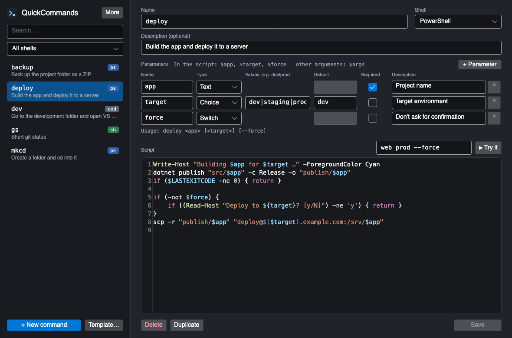
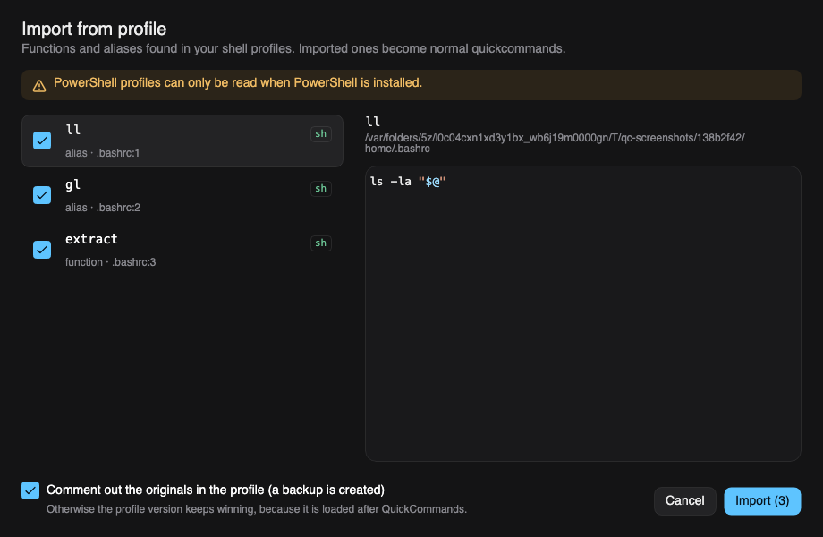
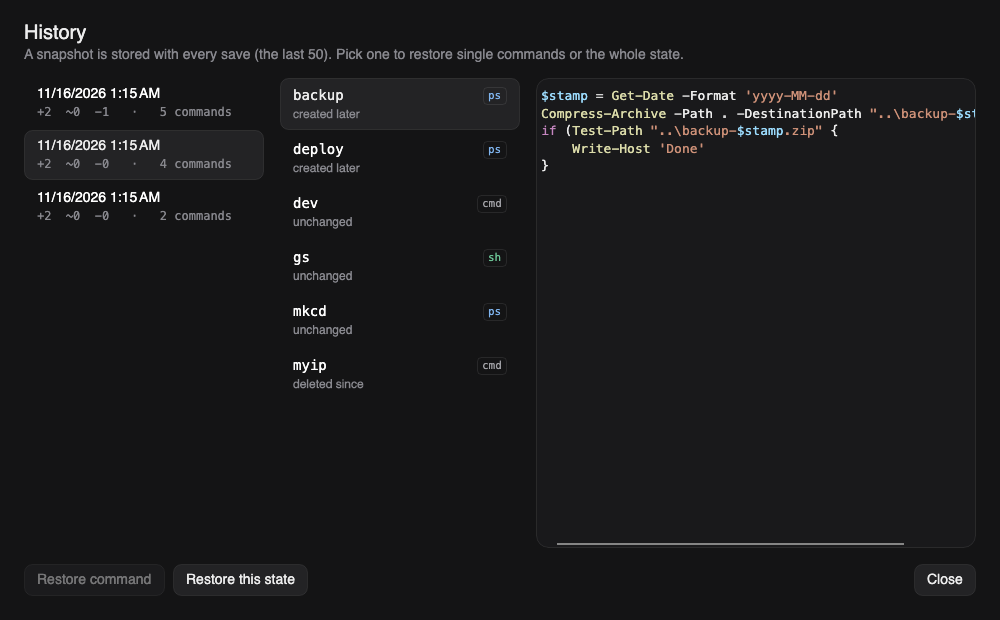

# QuickCommands

Eigene Terminal-Befehle per Oberfläche verwalten: Ein Wort wie `dev`, `mkcd` oder `deploy` führt ein Script aus,
in **PowerShell**, **cmd** oder **bash/zsh**. Speichern genügt, das Tool legt die Scripts an der richtigen Stelle ab.
Läuft auf Windows, macOS und Linux.



## Installation

| System | So geht's |
|---|---|
| Windows | `winget install FelixKriechbaum.QuickCommands` (sobald freigegeben) oder `QuickCommands-<version>-win-x64-setup.exe` aus den [Releases](../../releases) (ohne Adminrechte) |
| macOS | `QuickCommands-<version>-macos-arm64.zip` (Apple Silicon) bzw. `-x64.zip` (Intel) entpacken, App in den Programme-Ordner ziehen. Die App ist nicht notarisiert: beim ersten Start Rechtsklick → Öffnen (oder `xattr -dr com.apple.quarantine /Applications/QuickCommands.app`). |
| Linux | `QuickCommands-<version>-linux-x64.tar.gz` entpacken, `./install.sh` ausführen. Das legt einen Eintrag im App-Menü und `quickcommands` in `~/.local/bin` an. `./install.sh --uninstall` entfernt beides. |

Beim ersten Start fragt ein Assistent, welche Shells du nutzt und wo deine Commands liegen sollen. Vor jeder Änderung
zeigt er, was er anfassen wird. Beim Deinstallieren werden die Profilzeilen und der PATH-Eintrag wieder entfernt; deine
Commands bleiben erhalten.

## Funktionen

- **Liste aller Commands** mit Suche, Shell-Filter und Badge pro Shell
- **Code-Editor** mit Syntax-Highlighting. Syntaxfehler werden schon beim Tippen rot unterstrichen
  (PowerShell und bash/zsh; cmd hat keinen Parser, den man fragen könnte).
- **Parameter**: Name, Typ (Text, Schalter, Auswahl), Pflicht, Standardwert und Beschreibung im Formular festlegen.
  Daraus entstehen Argument-Parser, `--help` und Tab-Vervollständigung für alle Shells.
- **Ausprobieren** (F5): Der aktuelle Editor-Stand läuft in einem neuen Terminal, auch ungespeichert, mit
  Argumenten deiner Wahl. Gespeichert wird dabei nichts.
- **Automatisch aktuell**: Offene PowerShell-, bash- und zsh-Fenster übernehmen gespeicherte Änderungen von selbst.
  In cmd sind Änderungen ohnehin sofort da.
- **Vorlagen** (`mkcd`, `up`, `killport`, `serve`, `gac` …) als Startpunkt, **Duplizieren** (Strg+D)
- **Import aus dem Profil**: Funktionen und Aliase aus `$PROFILE`, `.bashrc` und `.zshrc` übernehmen. Die Originale
  werden auf Wunsch auskommentiert, vorher wird das Profil gesichert.
- **Verlauf**: Jedes Speichern sichert einen Stand (die letzten 50). Einzelne Commands oder den ganzen Stand kannst
  du wiederherstellen.
- **Konfliktprüfung**: Warnt, wenn ein Name ein vorhandenes Programm, einen Alias oder einen Shell-Befehl überdeckt.
  Interne cmd-Befehle wie `mkdir` oder `cd` werden blockiert, weil cmd sie immer selbst ausführt.
- `qc` im Terminal listet deine Commands. `qc -a` zeigt die aller Shells, `qc <name>` die Hilfe eines Commands und
  `qc reload` lädt neu.
- Datenordner verlegbar (OneDrive, NAS, Git), um Commands zwischen Rechnern zu teilen
- Oberfläche und Terminal-Ausgaben auf Deutsch und Englisch, hell/dunkel nach System

| | |
|---|---|
|  |  |
|  |  |

## Parameter

Für einen Command `deploy` mit den Parametern `app` (Text, Pflicht), `target` (Auswahl `dev|staging|prod`,
Standard `dev`) und `force` (Schalter) funktioniert in jeder Shell:

```text
deploy web                     # nach Position
deploy web prod --force        # gemischt
deploy --app=web --target prod
deploy -app web -target prod   # PowerShell-Stil, geht überall
deploy --help                  # Hilfe mit allen Parametern
```

Im Script stehen die Werte als Variablen bereit. Was keinem Parameter zugeordnet wird, bleibt in den üblichen
Argumenten:

| Shell | Parameter | übrige Argumente |
|---|---|---|
| PowerShell | `$app`, `$target`, `$force` (`$true`/`$false`) | `$args` |
| sh (bash/zsh) | `$app`, `$target`, `$force` (`1` oder leer) | `"$@"` |
| cmd | `%app%`, `%target%`, `%force%` (`1` oder leer) | `%*` enthält alle Original-Argumente |

Fehlt ein Pflichtwert oder passt eine Auswahl nicht, bricht der Command mit einer verständlichen Meldung ab.
In cmd laufen Commands mit Parametern isoliert (`setlocal`): ein `cd` bleibt erhalten, mit `set` gesetzte
Variablen nicht. Commands ohne Parameter verhalten sich wie gewohnt.

## So funktioniert es

| Shell | Mechanismus | Verfügbar |
|---|---|---|
| PowerShell (pwsh 7, optional 5.1) | `~/.quickcommands/qc.ps1` definiert Funktionen. Eine markierte Zeile in `$PROFILE` lädt die Datei. | sofort in offenen Fenstern (automatisches Nachladen) |
| cmd | eine `.cmd` pro Command in `~/.quickcommands/bin`. Der Ordner steht am Anfang des Benutzer-PATH. | sofort |
| bash / zsh | `~/.quickcommands/qc.sh` definiert Funktionen. Eine markierte Zeile in `.bashrc` bzw. `.zshrc` lädt die Datei. | ab dem nächsten Prompt (automatisches Nachladen) |

- Maßgeblich ist `commands.json` im Datenordner (Standard: `~/.quickcommands`). Alle anderen Dateien werden daraus
  erzeugt; der Verlauf liegt daneben in `history/`.
- Weil es Funktionen bzw. Batch-Dateien im selben Prozess sind, funktioniert auch `cd` in einem Command.
- Ein Syntaxfehler in einem Command erzeugt nur eine Warnung, die übrigen Commands laden trotzdem.
- Automatisches Nachladen: Die App schreibt neben `qc.ps1`/`qc.sh` eine kleine `.stamp`-Datei. PowerShell prüft sie,
  wenn ein Command aufgerufen wird (oder ein unbekannter Befehl fällt); bash und zsh prüfen sie vor jedem Prompt,
  ohne einen Prozess zu starten. Abschaltbar in den Einstellungen.
- Vor dem ersten Eingriff wird jedes Profil gesichert (`*.qc-backup`). Das Tool bearbeitet nur den Block
  zwischen `# >>> QuickCommands >>>` und `# <<< QuickCommands <<<`.

## Projektstruktur

```
src/QuickCommands.Core           Modelle, Speicherung, Generatoren, Profil-/PATH-Integration, Konfliktprüfung,
                                 Syntaxprüfung, Verlauf, Import, Vorlagen (ohne UI)
src/QuickCommands.App            Avalonia-Oberfläche (MVVM mit CommunityToolkit.Mvvm)
tests/QuickCommands.Tests        xUnit: Unit-Tests und Tests, die die erzeugten Scripts in pwsh, cmd, bash und zsh ausführen
tools/QuickCommands.Screenshots  rendert die Oberfläche headless mit Beispieldaten nach docs/screenshots
tools/strings.ps1                Quelle aller UI-Texte (de/en); erzeugt die .resx-Dateien
packaging/                       Inno-Setup-Script, macOS-App-Bundle, Linux-Paket, winget-Manifeste
```

## Entwickeln

```powershell
dotnet test                                    # alle Tests (Ausführungstests werden übersprungen, wenn eine Shell fehlt)
dotnet run --project src/QuickCommands.App     # App starten
dotnet run --project tools/QuickCommands.Screenshots -- docs/screenshots de
pwsh tools/strings.ps1 src/QuickCommands.App/Resources   # nach Änderungen an UI-Texten
.\install.ps1                                  # lokal bauen und für den eigenen Benutzer installieren
```

Die CI (`.github/workflows/ci.yml`) führt die Tests auf Windows, Linux und macOS aus und rendert die Oberfläche
headless auf Linux und macOS.

## Release

1. Version in `Directory.Build.props` erhöhen, committen.
2. Tag pushen: `git tag v0.2.0 && git push origin v0.2.0`
3. Der Workflow `release.yml` baut alle Plattformen und legt einen **Release-Entwurf** an mit Setup, portabler
   `.exe`, macOS-Zips, Linux-Archiv, `SHA256SUMS.txt` und den fertigen winget-Manifesten.
4. Entwurf prüfen und veröffentlichen. Ist das Secret `WINGET_TOKEN` gesetzt, reicht `winget.yml` die neue Version
   automatisch bei winget ein. Die erste Version muss einmal von Hand eingereicht werden, siehe
   [packaging/winget/README.md](packaging/winget/README.md).

## Lizenz

[MIT](LICENSE)
